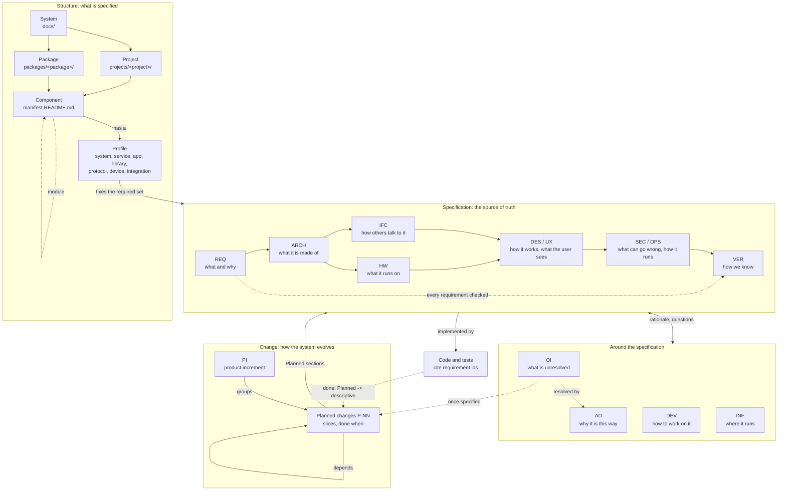
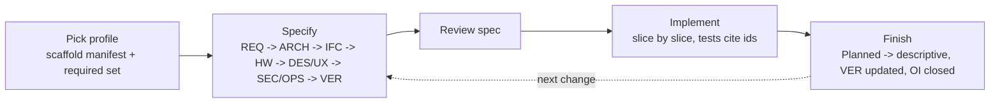

# Formulary

Formulary is a standard for specifying a technical system and everything in it: apps, services, libraries, protocols, firmware and integrations. Every part is specified the same way. The specification is the source of truth: code implements the spec, and a change starts in the spec.

| Document | Content |
| --- | --- |
| [profiles.md](profiles.md) | The profiles (kinds of component) and the documents each requires |
| [templates/](templates/) | One template per document type, plus the system manifest ([system.md](templates/system.md)), the project index ([project.md](templates/project.md)), the component manifest ([component.md](templates/component.md)) and the agent notes ([agents.md](templates/agents.md)) |
| [check-docs.py](check-docs.py) | The conformance check |

## Mental model

A system is split into projects, and projects into components. Each component has a profile, and the profile decides which document types it needs. The documents depend on each other in a fixed order, from what and why down to how it is checked. Product increments change them, and code implements them.



| Aspect | Holds | Where it is defined |
| --- | --- | --- |
| Structure | System, projects, packages, components and modules; each component's profile | [Workspace layout](#workspace-layout), [Modules](#modules), [profiles.md](profiles.md) |
| Specification | The type documents of each component, read from `REQ` down to `VER`; a later one refines an earlier one and never contradicts it | [Document types](#document-types), [Workflow](#workflow) |
| Around the specification | Decisions and open items, how to work on the code, the infrastructure it runs on | [Document types](#document-types) |
| Change | Product increments and the planned changes in them; once built, a change is folded into the specification and leaves the graph | [Product increments](#product-increments), [Planned work](#planned-work) |
| Relations | Every edge above that links documents is stated in front matter (`depends`, `related`, `planned`, `includes`) | [Front matter](#front-matter) |

## Terms

| Term | Meaning |
| --- | --- |
| **System** | The whole technical undertaking the standard is applied to: everything built and run together toward one purpose. It is specified with the `system` profile |
| **Workspace** | The repository (or set of repositories) that holds the system. Its root holds the system documents |
| **Project** | An independently developed codebase inside the system, with its own directory, tooling and owners. A project contains one or more components |
| **Component** | One thing that is specified, built and versioned as a unit: an app, service, library, protocol, device firmware or integration. A project may contain several, e.g. a device project with `firmware` and `gateway` |
| **Module** | A part of a component that needs an architecture of its own. It is described in sub-documents of the component's documents or, once it has requirements or an interface of its own, as a nested component ([Modules](#modules)) |
| **Profile** | The kind of component. It fixes which document types the component must have (its *required set*) |
| **Document type** | A fixed kind of document with a code (`REQ`, `ARCH`, ...) and a template |
| **Manifest** | The component's `README.md`: front matter stating id, profile, status, dependencies and documents |
| **Product increment** | A set of features the system gains together. The system evolves through product increments; each is specified in a `PI` document before it is built ([Product increments](#product-increments)) |
| **Item** | A numbered entry inside a document: requirement, decision, open item, interface message |

## Document types

| Code | Document | Sub-documents in | Answers | Template |
| --- | --- | --- | --- | --- |
| `REQ` | `requirements.md` | `requirements/` | What and why | [requirements.md](templates/requirements.md) |
| `ARCH` | `architecture.md` | `architecture/` | What it is made of | [architecture.md](templates/architecture.md) |
| `IFC` | `interfaces.md` | `interfaces/` | How others talk to it | [interfaces.md](templates/interfaces.md), [interface.md](templates/interfaces/interface.md) |
| `DES` | `design.md` | `design/` | How it works inside | [design.md](templates/design.md) |
| `UX` | `ux.md` | `ux/` | What the user sees and does | [ux.md](templates/ux.md) |
| `SEC` | `security.md` | `security/` | What can go wrong and how it is prevented | [security.md](templates/security.md) |
| `OPS` | `operations.md` | `operations/` | How it is built, configured, deployed and observed | [operations.md](templates/operations.md) |
| `HW` | `hardware.md` | `hardware/` | What it runs on | [hardware.md](templates/hardware.md), [board.md](templates/hardware/board.md) |
| `VER` | `verification.md` | `verification/` | How we know each requirement is met | [verification.md](templates/verification.md) |
| `DEV` | `development.md` | `development/` | How to work on it | [development.md](templates/development.md) |
| `INF` | `infrastructure.md` | `infrastructure/` | Which hosts and networks carry it | [infrastructure.md](templates/infrastructure.md) |
| `AD` | `decisions.md` | `decisions/` | Why it is this way | [decisions.md](templates/decisions.md) |
| `OI` | `open-items.md` | `open-items/` | What is unresolved | [open-items.md](templates/open-items.md) |
| `PI` | `increments.md` | `increments/` | How it evolves: which features it gains next | [increments.md](templates/increments.md), [increment.md](templates/increments/increment.md) |

| Rule | Detail |
| --- | --- |
| One document per type | An owner has at most one document of each type, named after the type: `architecture.md`. While the subject fits in one file, that file is the whole document |
| Sub-documents | When the document grows, parts move into sub-documents in the folder of the same name (`architecture/integration.md`). The type document keeps the summary and links every sub-document: it becomes their index. The folder exists only once there is a sub-document |
| One level | Sub-documents have no sub-documents. A part that needs more is a module ([Modules](#modules)) |
| Always split | `interfaces.md`, `hardware.md` and `increments.md` are indexes from the start. Every interface contract, every board and every product increment is a sub-document (`interfaces/http-api.md`, `hardware/<board>.md`, `increments/<increment>.md`), because each has its own version, data sheet or life span and a second one is always possible |
| The code | `REQ`, `ARCH`, ... is the short name of the type. It is the `type` in front matter and is used in the profile tables and in text. It does not appear in ids or file names |

**Scope.** `REQ` to `VER` belong to a component and form the required sets ([profiles](profiles.md)). The other five do not:

| Code | Belongs to | Lives in |
| --- | --- | --- |
| `DEV` | A project, because tooling is per project. Required for every project | `projects/<project>/docs/development.md`. Setup shared by the whole workspace is the system's: `docs/development.md` |
| `INF` | The system. Optional. A project adds its own only for infrastructure nothing else uses | `docs/infrastructure.md`; `projects/<project>/docs/infrastructure.md` |
| `AD`, `OI` | The system. They are logs of entries. A component keeps its own only for entries that affect nothing outside it | `docs/decisions.md` and `docs/open-items.md`; `<component>/decisions.md`, `<component>/open-items.md` |
| `PI` | The system. A project keeps its own only for increments that touch nothing outside it ([Product increments](#product-increments)) | `docs/increments.md` and `docs/increments/<increment>.md`; `projects/<project>/docs/increments.md` |

A component's `OPS` links to `INF` for hosts, networks and ports and to `DEV` for everyday commands; it never repeats them.

**Project level.** A project with several components may have a `requirements.md` and an `architecture.md` of its own, for what spans its components: the project's purpose and goals, how its components fit together. The rules for modules apply ([Modules](#modules)): the project's documents stay thin, and a project requirement is traced to the component requirements that meet it. A project's `decisions.md` and `open-items.md` hold what concerns only that project.

## Workspace layout

Every workspace that follows the standard has the same root. Code is grouped by project, not by kind, so a project's code and documents stay together.

```
<workspace>/
├── docs/                          the system (L0, L1)
│   ├── README.md                  system manifest and index of the projects
│   ├── requirements.md            the system's documents, one per type
│   ├── architecture.md
│   ├── architecture/              sub-documents of architecture.md
│   ├── increments.md              index of the product increments
│   ├── increments/                one document per product increment
│   └── decisions.md  open-items.md
├── projects/                      one folder per project
│   └── <project>/
│       ├── docs/                  (L2-L5)
│       │   ├── README.md          project index: its components, one line each
│       │   ├── development.md     how to work on the project
│       │   ├── <component>/       one folder per component
│       │   │   ├── README.md      manifest
│       │   │   ├── requirements.md  architecture.md  interfaces.md ...
│       │   │   ├── interfaces/    sub-documents: http-api.md ...
│       │   │   └── <module>/      optional nested component, same structure
│       │   └── guides/            optional user documentation: how-tos, concepts, reference
│       ├── <component>/           code of one component
│       └── AGENTS.md              short, project-specific agent notes
├── packages/                      shared libraries used by several projects
│   └── <package>/
│       ├── docs/                  README.md (manifest)  requirements.md  interfaces.md ...
│       └── src/
├── tools/                         workspace tooling: scripts, generators, docs checks
├── AGENTS.md                      workspace-wide agent rules; points to the standard
└── <root config>                  build, workspace and toolchain files only
```

| Folder | Holds | Never holds |
| --- | --- | --- |
| `docs/` | The system documents | Documents of a single project or component |
| `projects/<project>/` | Everything one project owns: code, documents, project tooling | Code another project imports (that goes to `packages/`) |
| `packages/<package>/` | A library with consumers in more than one project; it is one component, with profile `library` | Applications or services |
| `tools/` | Scripts and generators for the whole workspace | Project-specific scripts (those stay in the project) |

**Naming.** A component's name is the name of its code folder: `gateway` has its code in `projects/sensor/gateway/`, its documents in `projects/sensor/docs/gateway/` and the id `home/sensor/gateway`. The name is unique within its project only; the full id makes it unique in the system, so it does not repeat the project. Components of one kind may share a grouping folder (`projects/sensor/adapters/<name>/` -> `adapter-<name>`). A package's name is its folder name. The manifest's `code` field is authoritative where a project deviates.

**Reserved names.** A project, component or module is never named like a document type's file or folder (`requirements`, `architecture`, `interfaces`, `design`, `ux`, `security`, `operations`, `hardware`, `verification`, `development`, `infrastructure`, `decisions`, `open-items`, `increments`), nor `guides` or `packages`.

**Promotion.** When a second project needs code from a project, that code moves to `packages/` and becomes a `library` component with its own `IFC`. Projects never import from each other's folders.

## Where documents live

| Rule | Detail |
| --- | --- |
| Owner keeps it | A document lives in the project that owns the code it describes. A protocol lives with the project that defines it, e.g. `projects/sensor/docs/protocol/` |
| Single component | A project with one component may put the manifest and documents directly in `projects/<project>/docs/`. The manifest is then also the project index: L2 and L3 are one file and [project.md](templates/project.md) is not used |
| Root stays thin | `docs/` describes only what spans projects: goals, building blocks, integration, decisions, open items. It links to project documents and never repeats them |
| Reference, don't copy | A component using another's interface names its owner under `depends` in the manifest and links to that interface contract across projects |
| User documentation | `guides/` explains the project to its users: how-tos, concepts, reference. It links to the spec and never specifies behaviour itself; where both speak, the spec wins |
| Same standard everywhere | Project docs follow this standard at the version their index states; they do not copy the templates or rules |

## Modules

A component's `ARCH` names its building blocks. A block that needs an architecture of its own is a module. It is specified in one of two ways:

| | Sub-documents | Nested component |
| --- | --- | --- |
| When | The module has internal structure only: the component's requirements cover its behaviour and it has no contract of its own | The module has requirements of its own, an interface to the other modules, or is verified on its own |
| What | Sub-documents of the component's documents, named after the module: `architecture/editor.md`, `design/editor.md` | A component inside the component, with its own manifest, profile and required set |
| Id | `home/web/app/architecture/editor` | `home/web/app/editor`; its documents `home/web/app/editor/architecture`, ... |
| Folder | The component's type folders | `<component folder>/<module>/` |
| Items | Owned by the component: `home/web/app/FR-012` | Owned by the module: `home/web/app/editor/FR-003` |
| Relation | The id: the sub-document sits under the component's document | `parent: home/web/app` in the module's manifest |

| Rule | Detail |
| --- | --- |
| Start small | Begin with sub-documents. Promote the module to a nested component when its first own requirement or interface appears: the sub-documents move into its folder and become its type documents, and the references are updated in the same change |
| Any depth | A nested component may have modules of its own, in either form |
| Blocks point down | The Building blocks table of the parent's `ARCH` has a Specified in column naming the module's sub-document or the nested component |
| Parent stays thin | The parent's `ARCH` says how the modules fit together: the blocks, the dependency rules and the flows between them. It does not describe the inside of a module |
| Requirements | A parent requirement is either verified at the parent or met by module requirements. In the second case its `VER` row has the method `trace` and names those requirements |
| Interfaces | Modules talk to each other through the interface contracts of the module that provides the interface. A module's manifest names the sibling modules it uses under `depends` |
| Code | A module's code is a subfolder of the component's code; its manifest's `code` field names it |
| One tree | `parent` is stored in the module only. Which modules a component has is derived |

## System documents

The system is a component with profile `system` and follows the same rules as every other component. Only these points are specific to it:

| Rule | Detail |
| --- | --- |
| Location | `docs/`. `docs/README.md` is the system manifest and at the same time the index of the projects and packages (L0) |
| Documents | `requirements.md` (purpose, goals, constraints), `architecture.md` with its sub-documents (building blocks, integration, repository layout), `increments.md` with one sub-document per product increment, optionally `infrastructure.md`, `development.md` and `security.md`, and the system-wide logs `decisions.md` and `open-items.md` |
| Planned work | `increments.md` holds the overview of the open increments; each increment holds the graph of its changes ([Planned work](#planned-work)) |
| Verification | System requirements are met by components: each is traced to the component requirements that implement it, and those have the `VER` rows. A system `VER` exists only for checks that span projects |

## Progressive disclosure

Each level says just enough to decide whether to open the next one. Readers, people or agents, stop at the first level that answers their question.

| Level | Document | Answers | Size |
| --- | --- | --- | --- |
| L0 | `docs/README.md` | Which projects and system documents exist | One screen |
| L1 | `docs/architecture.md` and its sub-documents | How the projects fit together | Few pages |
| L2 | `projects/<project>/docs/README.md` | Which components the project has | One table |
| L3 | `<component>/README.md` (manifest) | Profile, dependencies, which documents exist | One screen |
| L4 | `requirements.md`, `architecture.md`, ... | The specification, or its summary and the index of its parts | As needed |
| L5 | `architecture/<name>.md`, `interfaces/<name>.md`, ... | One part in full | As needed |

Every document except the `AD` and `OI` logs opens with a one-paragraph summary and keeps detail lower down, or in a sub-document.

## Identifiers

Every artifact has exactly one fully qualified id. It is a path from the system down, and it is the only form used to refer to the artifact, in front matter and in text. A document's id is its path.

| Artifact | Id | Example |
| --- | --- | --- |
| System | `<system>` | `home` |
| Project | `<system>/<project>` | `home/sensor` |
| Package | `<system>/packages/<package>` | `home/packages/storage` |
| Component | `<project id>/<component>`; a package is its own component | `home/sensor/gateway` |
| Nested component (module) | `<component id>/<module>`, to any depth | `home/web/app/editor` |
| Type document | `<owner id>/<file name without .md>`; the owner is a component, a project or the system | `home/sensor/gateway/requirements`, `home/sensor/development`, `home/architecture` |
| Sub-document | `<type document id>/<file name without .md>` | `home/sensor/gateway/interfaces/http-api`, `home/architecture/integration` |
| Item | `<owner id>/<item>`; the owner is the component, project or system whose document defines it | `home/web/app/FR-012`, `home/AD-14` |

**Id and path.** A document's id is its path without `.md`, counted from the system. The workspace's `docs/` is the system's folder; `projects/` and the `docs/` segment inside a project or package are left out. A manifest or index (`README.md`) has the id of its folder.

| Path | Id |
| --- | --- |
| `docs/architecture/integration.md` | `home/architecture/integration` |
| `projects/sensor/docs/gateway/README.md` | `home/sensor/gateway` |
| `projects/sensor/docs/gateway/interfaces/http-api.md` | `home/sensor/gateway/interfaces/http-api` |
| `packages/storage/docs/requirements.md` | `home/packages/storage/requirements` |

Names of systems, projects, packages, components and sub-documents are lowercase kebab. In the templates, `<component-id>` stands for the component's full id.

| Item kind | Local form |
| --- | --- |
| Goal | `G-NN` |
| Functional requirement | `FR-NNN` |
| Operational requirement | `OR-NNN` |
| Interface message / endpoint | `MSG-NN` / `EP-NN` |
| Library function / command | `FN-NN` / `CMD-NN` |
| Conformance rule | `CF-NN` |
| Threat | `TH-NN` |
| Decision | `AD-NN` |
| Open item | `OI-NN` |
| Planned change | `P-NN` |

A document may define further kinds in the same form (`CH-NN` for channels, for example), in the place where it defines the items. Items belong to the owner, not to the document: `home/web/app/FR-012` stays the same when its document is split.

| Rule | Detail |
| --- | --- |
| Always qualified | A reference is the full id, also inside the artifact's own component: `home/web/app/FR-012`, never `FR-012` |
| Short form | Appears only where the artifact is defined or anchored in its own document: the id cell or heading that defines an item, a **Planned** marker, and labels inside diagrams. The `id` and `owner` in the document's front matter supply the rest |
| Links | A reference to a document is a link whose text is the id or the title |
| Never reused | A removed item keeps its row and is marked **Withdrawn** |

## Titles and file names

| Rule | Detail |
| --- | --- |
| Title | Every document has a `title` in its front matter. A type document's title is the name of its type (`Architecture`). A sub-document's title names its subject (`HTTP API`). A manifest's or index's title is the name of what it describes |
| Heading | The H1 is the title and nothing else: `# Architecture`, `# HTTP API`. The owner is not repeated; the id and `owner` in front matter say whose document it is |
| Type document | The file name is fixed by the type ([Document types](#document-types)) |
| Sub-document | The file name is the title slug: the title in lowercase, with every run of other characters replaced by `-`. `HTTP API` is `http-api.md` |
| Manifests and indexes | `README.md`, so that their folder shows them. Agent notes are `AGENTS.md` and have no front matter |
| Renaming and moving | Retitling a sub-document renames its file, and renaming or moving a file changes the id. The references are updated in the same change. Item ids are not affected |

## Status

| Applies to | Values |
| --- | --- |
| Component (manifest) | `draft` -> `active` -> `deprecated` |
| Document (front matter) | `Draft` until its first review is accepted, then `Accepted`. Later changes are reviewed in their PR and do not change the status. An `Accepted` document may contain **Planned** sections |
| Section or item | Unmarked = implemented and true. **Planned** = specified and reviewed, not built yet. A section carries the marker on the line below its heading; a table row carries it in its id cell (`FR-014 **Planned** P-03`). Both name the planned change ([Planned work](#planned-work)) |

## Front matter

Every document starts with YAML front matter. It is the machine-readable part: it identifies the document and holds every relation to other documents, so that tools and agents find what is related or dependent without parsing the text.

| Field | In | Meaning |
| --- | --- | --- |
| `id` | Every document | The full id ([Identifiers](#identifiers)) |
| `title` | Every document | The title ([Titles and file names](#titles-and-file-names)) |
| `type` | Every document | The document type code (`REQ`, `IFC`, ...); a sub-document has the type of its type document. Others: `manifest`, `index` |
| `owner` | Every document | Full id of the component, project or system the document belongs to |
| `standard` | System manifest, project index | The standard and version the documents conform to: `formulary/0.2` ([Conformance](#conformance)) |
| `status` | Every document but indexes | `Draft` or `Accepted`; in a manifest `draft`, `active` or `deprecated` |
| `version` | `IFC` | The semantic version of the contract. It changes with the contract, not with the wording |
| `date` | Every document | Date of the last change to the content, `YYYY-MM-DD`. Not a history; the history is in version control |
| `depends` | Documents | Full ids of the documents this one is derived from. A change to one of them may require a change here, and they are read first |
| `related` | Documents | Full ids of documents worth reading alongside, with no derivation either way |
| `planned` | Documents | The planned changes the document specifies, with their dependencies ([Planned work](#planned-work)). `[]` when there are none |
| `includes` | `PI` | Full ids of planned changes specified in component documents that belong to this increment ([Product increments](#product-increments)). `[]` when there are none |
| `profile`, `summary`, `code` | Manifest | Explained in [component.md](templates/component.md) |
| `documents` | Manifest | Full ids of the component's type documents. Sub-documents are listed by their type document |
| `depends` | Manifest | Full ids of the components whose interface this one uses. Together the manifests give the component graph |
| `implements` | Manifest | Full ids of `IFC` documents owned by another component that this one implements (a protocol, a plugin API) |
| `parent` | Manifest of a nested component | Full id of the component it is a module of. The list of a component's modules is derived from it |

| Rule | Detail |
| --- | --- |
| Relations live here | A relation between documents or components is stated in front matter. The text may link to the other document but adds no relation of its own |
| One end only | An edge is stored at the dependent end. The reverse direction (who depends on me, who consumes or implements this interface) is derived by tools, never written down |
| Full ids | Every value that names an artifact is its full id |
| Items | Relations between items (a requirement and its goal, a module and the requirements it satisfies, a check and its requirement) stay in the tables that define them |

```yaml
---
id: home/sensor/gateway/design
title: Design
type: DES
owner: home/sensor/gateway
status: Accepted
date: 2026-11-11
depends: [home/sensor/gateway/requirements, home/sensor/gateway/architecture, home/sensor/protocol/interfaces/wire-format]
related: [home/sensor/firmware/design]
planned:
  - id: home/sensor/gateway/P-02
    title: Batch upload
    depends: [home/P-01, home/packages/storage/P-03]
    done: [1]
---
```

## Writing rules

- **Descriptive.** Write what exists, what it does and what its contract is, in the present tense. Do not write task lists, journals or dated plan files. The one history kept in a document is the change table of an `IFC`. A `PI` describes a target state in the same way, and it is removed once that state is built ([Product increments](#product-increments)).
- **One fact, one place.** Link to a fact; never restate it. Requirements belong in `REQ`, contracts in `IFC`, rationale in `AD`.
- **Testable.** Every requirement has an acceptance criterion and at least one row in `VER`. A requirement that modules meet together has a `trace` row naming their requirements ([Modules](#modules)). System requirements are traced to component requirements in the same way (see [System documents](#system-documents)).
- **EARS for requirements.** `The <component> shall <response>.` / `When <trigger>, the <component> shall <response>.` / `While <state>, ...` / `If <unwanted condition>, then ...`
- **Diagrams** are Mermaid, kept next to the text that explains them.
- **Plain ASCII text.** Use `-` for dashes and ranges (never em or en dashes), `->` for arrows, `...` for ellipses, `>=` / `<=` for comparisons, and words instead of symbols: "section 5.5", not the section sign. Footnote markers are `(1)`, not superscripts. Box-drawing characters in directory trees inside code blocks are the only exception.
- **Guidance comments.** Templates carry `<!-- ... -->` notes saying what belongs in each section. Delete them once the section is filled. A section that does not apply reads `Not applicable - <reason>.`; it is never left out.

## Workflow

The same steps for every component and every change. "PR" below means one reviewed change set, whatever tool carries it.



1. **New component.** Pick its profile in [profiles.md](profiles.md). Copy [component.md](templates/component.md) to `projects/<project>/docs/<component>/README.md` (a package: `packages/<package>/docs/README.md`), copy the template of each document in the required set next to it, and add a row to the project index. A new project also gets its index ([project.md](templates/project.md)), its `development.md` and its `AGENTS.md` ([agents.md](templates/agents.md)).
2. **Specify.** Fill the documents in this order: REQ -> ARCH -> IFC -> HW -> DES / UX -> SEC / OPS -> VER. A later document may refine an earlier one but never contradict it. If it has to, change the earlier document first.
3. **Change.** Edit the spec before the code. New behaviour goes into the document that will describe it, as a section marked **Planned**, declared under `planned` in the document's front matter ([Planned work](#planned-work)), with two subsections:
   - **Slices**: independently shippable steps, in order. Finished slices are recorded in the entry's `done` list.
   - **Done when**: observable checks, which become `VER` rows.

   A change that spans projects, or a set of changes that together deliver one feature set, is a product increment: it gets a `PI` document ([Product increments](#product-increments)). Unresolved questions become `OI` entries and choices become `AD` entries.
4. **Review.** The spec change is reviewed on its own merits. A change that fits one PR is reviewed in that PR, together with the code. A larger change merges first, as a **Planned** section, and the code follows slice by slice.
5. **Implement.** Tests name the requirement they verify (the full id in a comment, or the local id `FR-012` in the test name). Each PR that implements a slice also carries the spec edits that slice makes true; code never lands ahead of its spec.
6. **Finish.** With the last slice, remove the **Planned** marker and rewrite the section descriptively. Set the `VER` rows to their test and status, and close the `OI` entries it resolved.

**Rule:** behaviour that no requirement covers is a defect, in the spec or in the code. Fix whichever is wrong.

## Planned work

Planned changes form a dependency graph, not a roadmap: there are no dates and no fixed order. The graph is held in front matter, so that tools can read it.

| Rule | Detail |
| --- | --- |
| Node | One planned change: an entry under `planned` in the front matter of the document that specifies it, plus the **Planned** section in that document with its slices. Its id is `<system>/P-NN` when it spans projects (it is then specified in a system `PI`) and `<component id>/P-NN` otherwise |
| Entry | `id` (full id), `title`, `depends`, and optionally `priority` (`must`, `should`, `could`) and `done` (the numbers of the finished slices) |
| Edge | `depends`: the full ids of the changes that must be done first, `[]` for none. Dependencies are stated there and nowhere else; the text does not repeat them |
| Anchor | The section carries `**Planned** P-03` on the line below its heading. A table row the change will build carries it in its id cell: `FR-014 **Planned** P-03` |
| State | Derived, never stored. *Done*: entry and marker removed. *In progress*: `done` is not empty. *Ready*: no id in `depends` is still an open entry. *Blocked*: anything else |
| Order | Any ready change may start |
| Overview | `docs/increments.md` lists the open increments and the graph between them; each `PI` holds the table and Mermaid graph of its own changes. Both are views of the front matter: generated by `tools/` where a generator exists, kept by hand until then |
| Ids | Never reused. A finished change leaves the graph and is removed from the `depends` lists that named it; an id in `depends` that matches no entry is an error |
| Not in the graph | Intent that is not specified yet. It stays an `OI` entry until someone writes the **Planned** section |

## Product increments

The system evolves through product increments. A product increment is a set of features the system gains together: new behaviour, a new component, a restructuring. Its `PI` document says what the increment delivers and which planned changes deliver it. The type documents (`REQ`, `ARCH`, `IFC`, ...) describe the system as it is; a `PI` describes one step from there to a target.

| Rule | Detail |
| --- | --- |
| Owner | The system: `docs/increments/<increment>.md`, id `<system>/increments/<increment>`. A project keeps its own `increments.md` only for increments that touch nothing outside it |
| Index | `increments.md` lists every open increment, one line each, with the graph between them. An increment that builds on another names it under `depends` in its front matter |
| Content | Goal (what the system can do afterwards, and the system goals and requirements it serves), scope (its features and what is left out), the target state, and its planned work ([increment.md](templates/increments/increment.md)) |
| Changes | The increment's own changes (`<system>/P-NN`) are declared under `planned` in its front matter and specified in its sections. A feature wholly inside one component stays a **Planned** section of that component's document; the increment names that change under `includes` |
| One fact, one place | A target that a type document will describe once built (a requirement, a contract, a layout) is written in the `PI` only while it is planned. The slice that builds it moves it into the type document |
| State | Derived, never stored. *Open*: at least one change under `planned` or `includes` is still an open entry. *Done*: none is. A done increment is removed from the index and its file is deleted; it remains in version control |
| Status | `Draft` until the increment is reviewed and accepted as a whole, then `Accepted` |

## Conformance

| Rule | Detail |
| --- | --- |
| State it | The system manifest (`docs/README.md`) and every project index carry `standard: formulary/<version>` in their front matter: the version of this standard their documents conform to |
| Reference, don't copy | Documents link to the standard. Its rules and templates are not copied into the workspace |
| Check it | [check-docs.py](check-docs.py) tests what can be tested mechanically: front matter, id equals path, links, referenced ids, plain ASCII. It runs on a whole workspace, or on one `docs` folder with its id prefix |
| Versions | The standard is versioned `major.minor.patch`. A change that makes conforming documents non-conforming raises the major version (before 1.0, the minor version) |

## For agents

- Take work from the planned-work graph: only changes that are ready. Start at `docs/increments.md` to see which increments are open.
- Refer to every artifact by its full id.
- Go down the levels: project index -> component manifest -> documents. Load only what the task needs.
- Find what else to read from front matter: `depends` and `related` of the document, `depends` and `implements` of the manifest.
- A manifest with `parent` describes a module: read the parent's `ARCH` before the module's documents.
- The manifest lists the profile, the documents and the dependencies. Read `REQ` and the `IFC` of every dependency before reading or writing code.
- Never implement a **Planned** section partially without saying which slices are done.
- If the spec is silent or ambiguous, add an `OI` entry and ask; do not invent behaviour.
- When code and spec disagree, report it. Do not silently change either.
