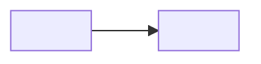

<!-- Component manifest. Copy to projects/<project>/docs/<component>/README.md (shared packages: packages/<name>/docs/README.md) and add a row to the project index projects/<project>/docs/README.md.
     A nested component (module): copy to <parent component folder>/<module>/README.md; its id is <parent id>/<module> and its owner is the parent.
     In a project with a single component the manifest may be projects/<project>/docs/README.md itself; it is then also the project index.
     `status` is draft, active or deprecated. `date` is the date of the last change to the manifest.
     `documents` lists the full id of each type document the component has: the required set of the profile (Formulary, profiles.md) plus any optional ones. Sub-documents are not listed here; their type document lists them.
     `depends` lists the full ids of the components whose IFC this component uses; tools read the component graph from it.
     `implements` lists the full ids of IFC documents owned by another component that this one implements (a protocol, a plugin API). -->

# <Component name>

<!-- Two or three sentences: what it is, who uses it, where it runs. -->

| Document | Title |
| --- | --- |
| [<component-id>/requirements](requirements.md) | Requirements |
| [<component-id>/architecture](architecture.md) | Architecture |
| [<component-id>/design](design.md) | Design |
| [<component-id>/verification](verification.md) | Verification |

## At a glance

<!-- One Mermaid diagram showing the component and its direct neighbours. -->

## Dependencies

| Component | Uses | Interface |
| --- | --- | --- |
| <component-id> | <what for> | [IFC](<relative path to that component's interfaces.md>) |
