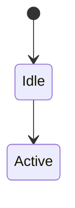

# Design

<Summary: one paragraph saying what this document establishes and its main points.>

<!-- How the component works inside: precise enough that two people would implement it the same way.
     Organise by building block from ARCH. When it grows past ~400 lines, move a building block into a sub-document, design/<block>.md (id <component-id>/design/<block>); design.md keeps the summary and links it.
     A planned change goes in the section it will change, marked `**Planned** P-NN` and declared under `planned` in the front matter, with Slices and Done when (Formulary README, Workflow and Planned work). -->

## 1 Module structure

<!-- Source layout and the responsibility of each module. Mirror the repository. -->

| Module | Path | Responsibility | Satisfies |
| --- | --- | --- | --- |
| <name> | <path> | <responsibility> | <component-id>/FR-001, <component-id>/FR-004 |

## 2 Data model

<!-- Entities, fields, relations, invariants, persistence. Mermaid erDiagram or classDiagram where useful. -->

## 3 State and behaviour

<!-- State machines (stateDiagram-v2), lifecycles, algorithms, concurrency (processes, tasks, locks). -->

## 4 Key flows

<!-- Internal sequences that are not visible at ARCH level. -->

## 5 Configuration

| Key | Type | Default | Meaning |
| --- | --- | --- | --- |
| <key> | <type> | <default> | <meaning> |

## 6 Error handling

<!-- Failure modes per module and the response: retry, degrade, surface to user, crash and restart. -->

| Failure | Detected by | Response |
| --- | --- | --- |
| <failure> | <mechanism> | <behaviour> |

## 7 Extension points

<!-- Where and how the component is meant to be extended: plugins, providers, hooks. Or `Not applicable - <reason>.` -->
