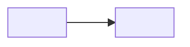

# Increments

<Summary: one paragraph saying which increments are open and where the system is heading.>

<!-- Index of the open product increments. Every increment is a sub-document in increments/ (template: increments/increment.md).
     A done increment is removed from this table and its file deleted (Formulary README, Product increments). -->

## 1 Increments

| Increment | Summary |
| --- | --- |
| [<system>/increments/<increment>](increments/<increment>.md) | <one line: the features it delivers> |

## 2 Graph

<!-- The increments and the depends edges between them, a view of their front matter. One node per increment; the changes inside an increment are in its own document. -->

