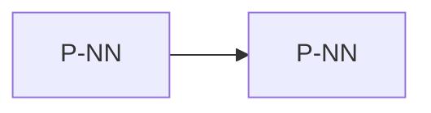

# <Increment>

<Summary: one paragraph saying what the system gains with this increment.>

## 1 Goal

<!-- What the system can do once the increment is done, and the system goals and requirements it serves, by full id. -->

## 2 Scope

<!-- One row per feature. Change names the planned change that delivers it: one of this document's (`planned`) or a component change (`includes`). Target names the document that will describe the feature once it is built. -->

| Feature | Change | Target |
| --- | --- | --- |
| <feature> | <system>/P-NN | <document id> |

Out of scope: <what a reader might expect here but is left to a later increment or an OI entry>.

## 3 Target state

<!-- One subsection per change declared under `planned`: the target the change builds, with its **Planned** marker, Slices and Done when (Formulary README, Workflow).
     Component changes listed under `includes` are specified in their own documents and are not repeated here. -->

### 3.1 <Change>

**Planned** P-NN

<Target state.>

**Slices**

1. <independently shippable step>

**Done when**

- <observable check>

## 4 Planned work

<!-- Graph and table of the increment's changes, a view of the front matter (`planned` and `includes`). State is derived: ready, in progress or blocked. -->

| Id | Content | Depends on | State |
| --- | --- | --- | --- |
| P-NN | <change> | - | ready |
