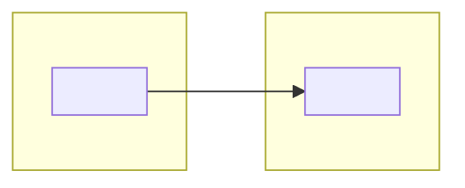

# Infrastructure

<Summary: one paragraph saying what this document establishes and its main points.>

<!-- The hosts, networks and shared services that carry the system, and how they are connected.
     System level: id <system>/infrastructure, file docs/infrastructure.md. A project uses this template (id <system>/<project>/infrastructure) only for infrastructure nothing else uses.
     Never put secret values here, only names and where they come from. -->

## 1 Overview

<!-- One diagram: zones, hosts and the connections between them. -->

## 2 Hosts

| Host | Role | Location | Platform | Runs |
| --- | --- | --- | --- | --- |
| <name> | <purpose> | <site / provider / device> | <OS, architecture, size> | <components, services> |

## 3 Networks and zones

| Network | Range | Purpose | Reachable from |
| --- | --- | --- | --- |
| <name> | <CIDR / SSID / VLAN> | <purpose> | <zones, internet, VPN only> |

## 4 Endpoints and ports

| Service | Host | Port / protocol | Exposed to | Interface |
| --- | --- | --- | --- | --- |
| <component or service> | <host> | <port, protocol> | <zone / internet / localhost> | <link to its IFC> |

## 5 Names and certificates

<!-- DNS names and who serves them, TLS certificates: issuer, where stored, how renewed. -->

| Name | Points to | Certificate | Renewal |
| --- | --- | --- | --- |
| <fqdn> | <host / service> | <issuer> | <automatic / manual, interval> |

## 6 Access

<!-- How people and machines get in: VPN, SSH, firewall rules, identities, who may do what. -->

| From | To | Allowed | Enforced by |
| --- | --- | --- | --- |
| <zone / role> | <zone / host> | <ports, protocols> | <firewall / VPN / reverse proxy> |

## 7 Shared services

<!-- Platform services several components use: databases, brokers, registries, secret store, object storage. -->

| Service | Host | Used by | Data | Owner |
| --- | --- | --- | --- | --- |
| <service> | <host> | <components> | <what it holds> | <who operates it> |

## 8 CI/CD

<!-- Pipelines, runners, where artefacts are stored, what triggers a deployment. Per-component steps are in OPS. -->

## 9 Backup and recovery

| Data | Backed up to | Interval | Restore procedure |
| --- | --- | --- | --- |
| <data> | <target> | <interval, retention> | <steps or link> |
