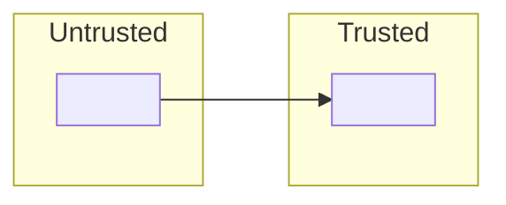

# Security and Privacy

<Summary: one paragraph saying what this document establishes and its main points.>

## 1 Assets

<!-- What is worth protecting: data, credentials, compute, devices, user trust. -->

| Asset | Sensitivity | Stored where |
| --- | --- | --- |
| <asset> | <high / medium / low> | <location> |

## 2 Trust boundaries

<!-- Where data crosses from less-trusted to more-trusted zones. Diagram recommended. -->

## 3 Threats

<!-- STRIDE as a checklist: spoofing, tampering, repudiation, information disclosure, denial of service, elevation of privilege. -->

| Id | Threat | Asset | Mitigation | Status |
| --- | --- | --- | --- | --- |
| TH-01 | <threat> | <asset> | <control> | mitigated / accepted (<full AD id>) / open (<full OI id>) |

## 4 Authentication and authorisation

<!-- Who can do what, how identity is established, how secrets are issued, stored and rotated. -->

## 5 Privacy

<!-- Personal data collected, purpose, retention, where it leaves the component (third-party APIs), user controls. -->

| Data | Purpose | Retention | Leaves to |
| --- | --- | --- | --- |
| <data> | <purpose> | <period> | <processor / none> |

## 6 Secure defaults and hardening

<!-- Defaults, sandboxing, dependency policy, update path. -->
