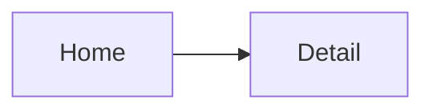

# UI Design

<Summary: one paragraph saying what this document establishes and its main points.>

<!-- What the user sees and does. For a CLI or TUI: commands, screens, keybindings and output formats. -->

## 1 Principles

<!-- 3-5 rules every screen follows, e.g. "keyboard first", "one primary action per screen". -->

## 2 Information architecture

<!-- Screens or views and how they connect. -->

## 3 Layout and breakpoints

<!-- GUI: viewports. TUI: minimum terminal size and what happens below it. CLI: `Not applicable - <reason>.` -->

| Viewport | Width | Layout |
| --- | --- | --- |
| Phone | < 768 | <layout> |
| Desktop | >= 1024 | <layout> |

## 4 Screens and commands

<!-- One subsection per screen (GUI, TUI) or per command (CLI).
     For a command, replace the rows Entry and Primary action with Synopsis, Options, Output (stdout, stderr, format) and Exit codes, and drop States and Elements. -->

### 4.1 <Screen>

| Item | Value |
| --- | --- |
| Purpose | <what the user achieves here> |
| Entry | <how the user gets here> |
| Primary action | <action> |
| Satisfies | <component-id>/FR-NNN |

**States:** empty, loading, populated, error, <other>

**Elements:**

| Element | Behaviour |
| --- | --- |
| <element> | <what it shows, what interaction does> |

## 5 Flows

<!-- Multi-screen tasks, step by step, including the error path. -->

## 6 Interaction and input

<!-- Keybindings, gestures, focus order, drag and drop. -->

| Input | Context | Action |
| --- | --- | --- |
| <key / gesture> | <where> | <effect> |

## 7 Visual language

<!-- Tokens, typography, icons, motion. Link to the design system if there is one instead of repeating it. -->

## 8 Accessibility

<!-- Contrast, keyboard reachability, screen reader labels, reduced motion. -->
